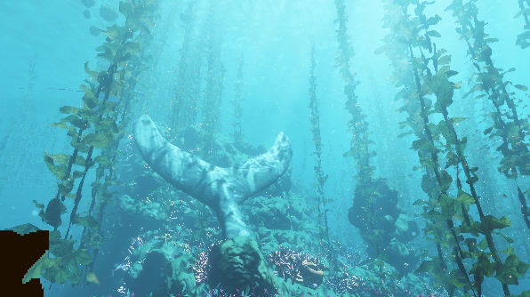
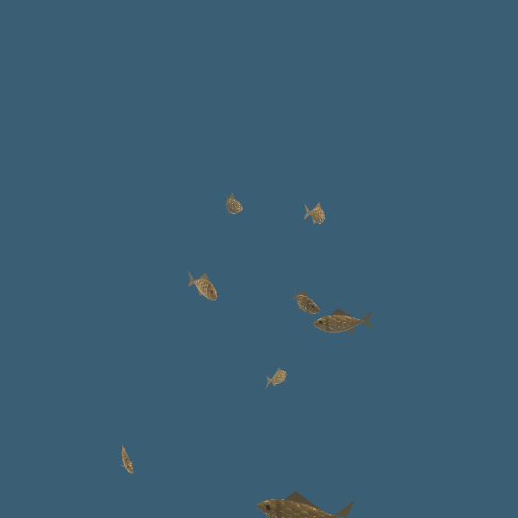
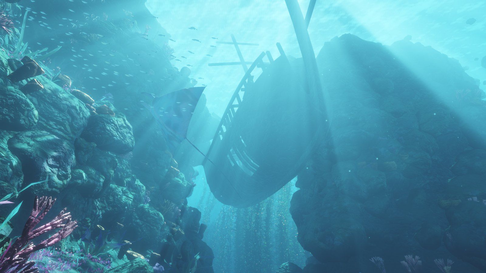
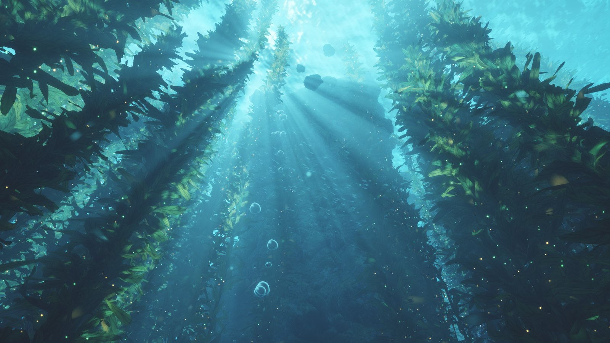
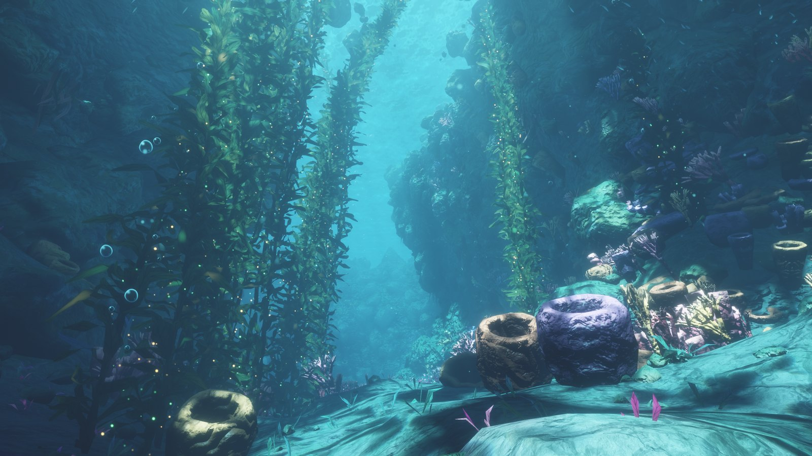
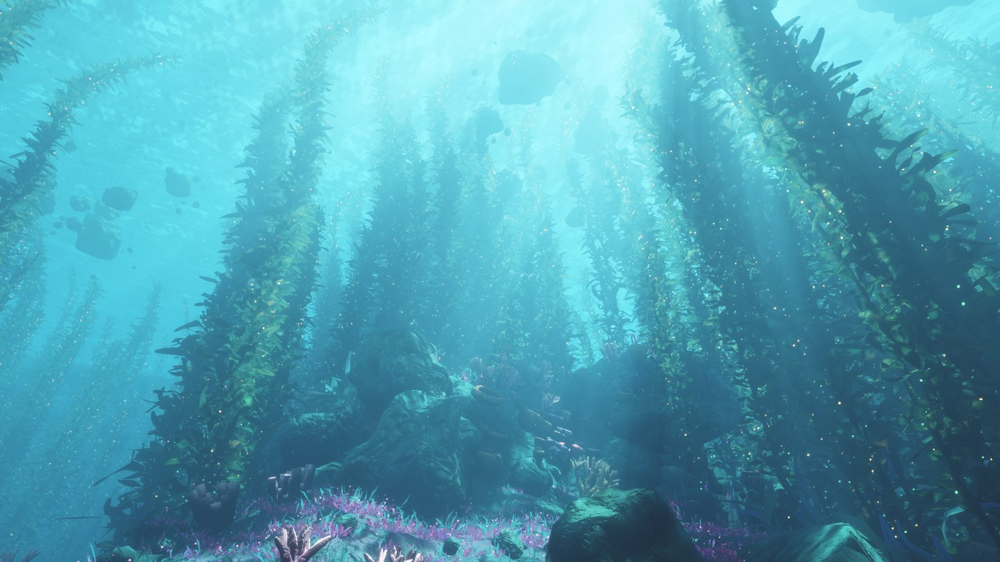
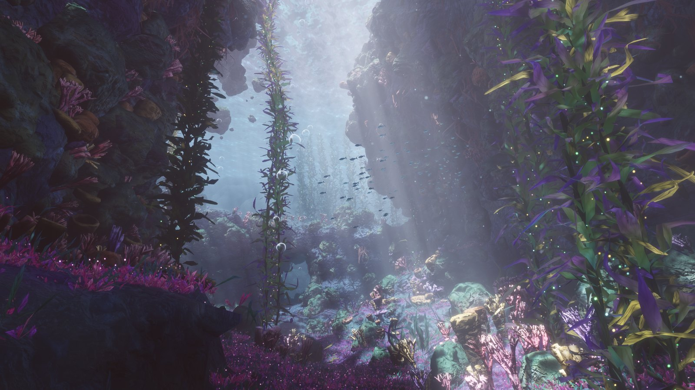

# Abyssal Garden — Goldfish

**A dreamy underwater world you can swim through, right in your browser — now with golden fish.**

This is a **gold-fish variant** of [Abyssal Garden](https://github.com/Noniv/abyssal-garden), the procedural
WebGPU underwater scene by **Noniv** (Maksymilian Dendura), used under the MIT license. Everything about the
original world is here — towering kelp forests, sunbeams pouring through a rippling surface, a sunken ship,
manta rays gliding overhead — and every fish in every school is now **gold**: a metallic, underwater gold with
warm highlights and deep amber in shadow, on more realistically shaped bodies with fins, eyes and a scaly
sheen. As in the original, all of it is made by code: no images, no 3D models, no sound files. The whole
world fits in **one self-contained HTML file**.





## Try it

1. Download [`index.html`](index.html).
2. Open it in **Chrome** or **Edge** on a **desktop** computer.
3. Wait a few seconds while the world is built, then press **Dive in** and start swimming.

Nothing to install, and it works offline. The scene needs a browser with **WebGPU** (current Chrome or Edge
have it). If you see *"This scene needs WebGPU"*, update your browser or switch to Chrome / Edge.

## What's down there

- **Schools of golden fish** — metallic gold flanks that glint in the sunbeams, amber in shadow, with
  forked tails, dorsal and pectoral fins, dark eyes and a subtle scale pattern. Each fish varies a little
  in tone.
- **Kelp forests** that sway in the current and sparkle with tiny gold and green specks
- **Light rays** streaming down from a wavy surface, with shimmering caustics on the sea floor
- **A sunken wooden ship**, a **giant stone whale tail**, rock arches, canyons and floating boulders
- **Manta rays**, rising bubbles and drifting particles
- **A purple grotto** with glowing magenta ground cover, coral and barrel sponges
- **A soundscape** made up as you listen: a deep rumble, distant whale calls, soft chimes and bubbles

| | |
|---|---|
|  |  |
|  |  |



*(World shots from the original project — everything but the fish is unchanged here.)*

## Controls

| | Keyboard & mouse |
|---|---|
| Look around | Move the mouse |
| Swim | `W` `A` `S` `D` |
| Up / down | `E` / `Q` |
| Swim faster | Hold `Shift` |
| Jump to a viewpoint | `1` to `6` |
| Menu | `Esc` releases the mouse and opens the menu with the list of controls |
| Sound on / off | `M` (sound starts when you dive in) |
| Performance stats | `H` |
| Detail level | **Low**, **Medium** or **High** in the menu (reloads the page) |

The seabed, cliffs and arches are solid: you glide along the rock instead of swimming into it. Kelp, plants,
corals, sponges, loose rocks, the floating boulders, the ship, the whale tail and the fish you can swim through.

**On a touchscreen:** hold one finger down to swim forward and slide it to steer. Put a second finger down to
go faster. The `≡` button in the corner opens the menu. (Touch support is experimental.)

## What changed from the original

- `source/src/shaders.js` — the fish fragment/vertex shaders: gold metallic shading (sharp gold specular
  highlight, broad sheen, warm fresnel rim), a procedural overlapping-scale bump pattern, caustic light on
  the water above them, dark eyes with a glint, a gill shading, translucent-looking fins, and a subtle
  tone variation between fish. The manta ray and everything else are untouched.
- `source/src/world.js` — the fish mesh: a properly proportioned body with a smooth profile, forked caudal
  fin, dorsal, anal and pectoral fins, capped nose and tail (the original was a hexagonal tube with a
  flat tail).
- `index.html` — rebuilt from that source with `npm run build`.

## Make it your own

The readable source code is in the [`source`](source) folder. To change something and rebuild `index.html`
you need [Node.js](https://nodejs.org) 18 or newer:

```bash
cd source
npm install
npm run build
```

This writes a new self-contained `index.html` next to this README — a future rebuild produces the same
gold-fish look. `npm run build:readable` writes an unminified version instead, which is easier to debug in
the browser's developer tools.

| File | What's inside |
|---|---|
| [`source/src/world.js`](source/src/world.js) | The world layout: rock walls, arches, tunnels, kelp forests, sponge gardens, fish schools, mantas, the ship, the whale tail — and the fish mesh |
| [`source/src/shaders.js`](source/src/shaders.js) | The look: water and fog colors, lighting, kelp, rocks, the fish, the water surface and light rays (WGSL shader code) |
| [`source/src/main.js`](source/src/main.js) | The renderer, the camera, the controls, the six viewpoints |
| [`source/src/audio.js`](source/src/audio.js) | The soundscape |
| [`source/src/quality.js`](source/src/quality.js) | The detail levels |
| [`source/src/math.js`](source/src/math.js) | Noise, random numbers and mesh-building helpers |
| [`source/template.html`](source/template.html) | The page around the scene: loading bar, start menu, links and their styles |
| [`source/build.mjs`](source/build.mjs) | Bundles everything into the single `index.html` |

Some easy first tweaks:

- **Water color:** `WCOL` (blue-green water) and `PCOL` (purple grotto) near the top of the shared scene code in `shaders.js`
- **Sunlight color:** `SUNC` right next to them
- **Fish gold tone:** the `alb` colors in `fsFish` in `shaders.js`
- **Swimming speed:** search for `26 : 7` in `main.js` (fast speed : normal speed)

## License

[MIT](LICENSE): free to use, change and share, including in your own projects.
The original project is [Abyssal Garden](https://github.com/Noniv/abyssal-garden) by
[Noniv](https://github.com/Noniv) — all credit for the world, the renderer and the general design goes to him.
